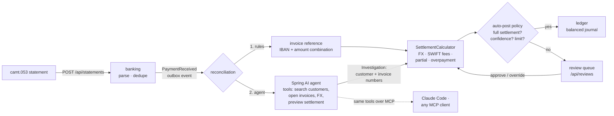

# cashmatch-agents

**Agentic cash application for cross-border B2B receivables.** International customers pay in
EUR, USD, GBP and CHF, through correspondent banks that deduct fees, convert currencies and
truncate references. This service reads ISO 20022 bank statements, works out which invoices
each payment settles, books it to a double-entry ledger, and sends what it cannot prove to a
human.

Deterministic rules handle the easy majority. A Spring AI agent with read-only tools
investigates the rest. **The agent never decides amounts and never posts on its own**: it proposes
*which* invoices, the settlement calculator does the money math, and a policy decides whether
the proposal is safe to auto-post.



## What it handles

The sample statement (`src/main/resources/samples/camt053-2026-10-20.xml`) exercises each case,
and `ReconciliationFlowIT` asserts every outcome on real Postgres:

| Payment | What happens | Handled by |
|---|---|---|
| EUR 12 400, reference `INV-2026-0101` | exact match | rule: reference |
| GBP 4 980 for two invoices of GBP 5 000, references `Inv 2026/102 + Inv 2026/103`, SHA charges | both invoices paid in full, GBP 20 booked as bank charges | rule: reference |
| EUR 9 995 for a CHF 9 380 invoice, payer instructed CHF 9 380, no reference | invoice paid in full, CHF 4.69 FX loss booked | rule: IBAN + amount |
| USD 7 250 from "SAKURA COMPONENTS KK TOKYO", no IBAN, reference "PO 4471/4472" | agent finds the customer by fuzzy name and the two invoices that sum to 7 250 | agent → policy → auto-post |
| EUR 1 500 from an unknown company, reference "PAYMENT" | no guess | agent → review |
| USD 10 000 against a USD 15 000 invoice | partial payment, invoice stays open for 5 000 | rule: reference |
| USD 48 000 with a valid reference | above the auto-post limit | rule → review |
| Agent confidently proposes another customer's invoice | blocked: customer does not own the invoice | policy → review |
| Same statement uploaded twice | nothing booked twice | unique bank reference + journal key |

## Design decisions

**LLM proposes, code disposes.** The agent's output type (`Investigation`) contains a customer id
and invoice numbers — no amounts. `SettlementCalculator` computes the settlement for any proposal,
from a rule, the agent or a human reviewer, with the same code. The agent can call
`previewSettlement` to check itself, but the policy re-checks independently.

**The FX difference is the fraud-and-mistake detector.** Every settlement is balanced by construction:
`received + bank charges + FX difference = allocated + unapplied`. The FX difference is the plug.
If it is larger than the tolerance (0.5% cross-currency, one cent same-currency) the match is wrong,
whoever proposed it.

**Money is `BigDecimal` at the currency's minor-unit scale**, rounded half-even, with currency
mismatches as exceptions. JPY has no decimals, BHD has three; `Money` knows that.

**SWIFT charge bearer matters.** A short payment under `SHAR`/`CRED` within the fee tolerance is
settled in full with the gap booked as bank charges. Under `DEBT` (OUR) the payer covers fees, so
the same gap is a partial payment.

**No LLM call inside a database transaction.** Reconciliation reads, investigates (possibly seconds
of model time) and only then opens a short transaction that re-checks the payment status with a
compare-and-set. Concurrent workers cannot double-post; the journal's unique key is the second fence.

**Agent failures degrade to review.** A timeout, overload or unparseable output becomes
`NO_MATCH` with the reason attached. The payment queue never stops because a model did.

**Guaranteed delivery.** `PaymentReceived` goes through the Spring Modulith event publication
registry (transactional outbox on Postgres) and is republished on restart if processing did not finish.

**Module boundaries are tested.** Spring Modulith verifies that modules only use each other's
public API and that there are no cycles; the build writes PlantUML diagrams of the module graph.

```
money           OPEN   Money, rounding, currency safety
fx                     ECB reference rates, staleness-checked conversion, immutable-fixing cache
invoicing              customers, invoices, trigram customer search, payment application
banking                camt.053 parser (XXE-safe, batch bookings split), idempotent ingestion, PaymentReceived
ledger                 double-entry journal, balance check per currency, idempotent posting
reconciliation         rules, settlement calculator, auto-post policy, review queue
agent                  Spring AI investigator, read-only tools, MCP server
```

## Stack

Java 25 LTS (records, sealed types, record patterns in `switch` with guards, unnamed
variables, virtual threads, compact object headers) · Spring Boot 4.1 ·
Spring AI 2.0 (ChatClient, `@Tool` calling, structured output, MCP server over Streamable HTTP) ·
Anthropic Claude · Spring Modulith 2.1 (module verification, event publication registry) ·
Spring Data JDBC / `JdbcClient` · PostgreSQL 17 + `pg_trgm` · Flyway · Testcontainers ·
Micrometer/Actuator · GitHub Actions.

## Run it

```bash
export ANTHROPIC_API_KEY=...        # optional: without it, unmatched payments go to review
docker compose up --build

curl -X POST localhost:8080/api/statements -H 'Content-Type: application/xml' \
     --data-binary @src/main/resources/samples/camt053-2026-10-20.xml

curl localhost:8080/api/reviews | jq                         # what needs a human
curl -X POST localhost:8080/api/reviews/<id>/approve -H 'Content-Type: application/json' \
     -d '{"reviewer": "anna@finance", "invoiceNumbers": ["INV-2026-0109"]}'
```

Local development with a throwaway database: `./mvnw spring-boot:test-run`.

### Use the receivables tools from Claude Code

The agent's tools are also published as an MCP server at `http://localhost:8080/mcp`
(`.mcp.json` is included). In Claude Code: *"Which open invoices does Sakura Components have,
and how would a USD 7 250 payment settle them?"*

Tools: `searchCustomers`, `customerByIban`, `openInvoices`, `findInvoice`, `convert`,
`previewSettlement` — all read-only.

## Tests

```bash
./mvnw verify
```

- `SettlementCalculatorTest` — exact, SHA fees, OUR fees, instructed-amount FX, relative FX
  tolerance, FIFO partials, overpayment, wrong-match detection; every case checks the journal balances
- `Camt053ParserTest` — camt.053.001.08 and .001.02 layouts, batch bookings, debits skipped, XXE rejected
- `LlmPaymentInvestigatorTest` — structured output parsing and tool registration through a fake
  `ChatModel`; model outage and garbage output both become reviews
- `ModularityTest` — Spring Modulith boundary verification + diagrams
- `ReconciliationFlowIT` — the whole flow on Testcontainers Postgres with a scripted agent:
  every row of the table above, idempotent re-upload, policy blocking a wrong agent, reviewer
  approval, a reviewer override the calculator rejects, double rejection, and the agent's
  tools on the same data. Only the LLM is replaced; database, HTTP, events and ledger are real
- `AgentLiveEvalIT` — the real model on the sample statement; runs when `ANTHROPIC_API_KEY` is set

## Next steps

- Store each investigation's tool trace next to the review task for audit
- Learn payer aliases from approved reviews (debtor name/IBAN → customer) so the rules catch them next time
- Remittance advice e-mails as a second input channel (the agent already reasons over free text)
- Per-tenant tolerances and approval limits with four-eyes approval above a threshold
